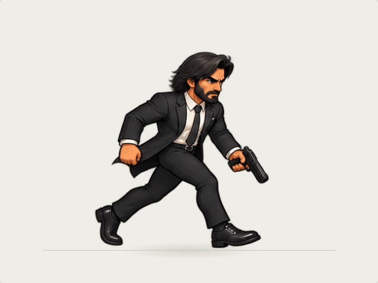
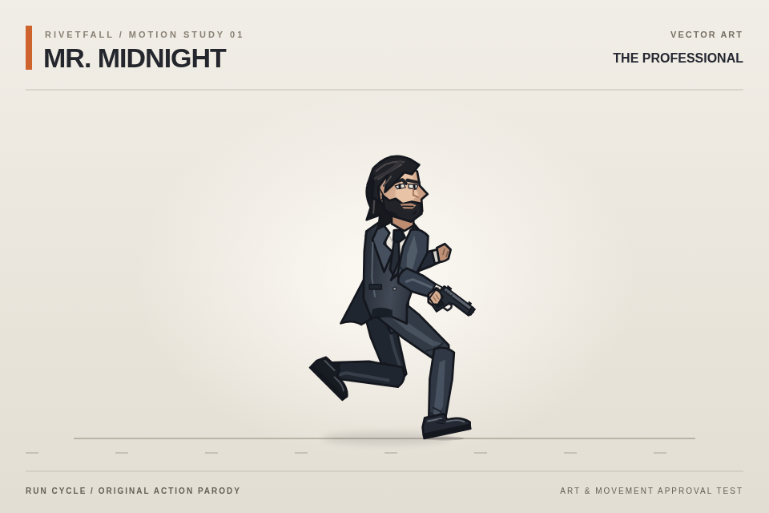
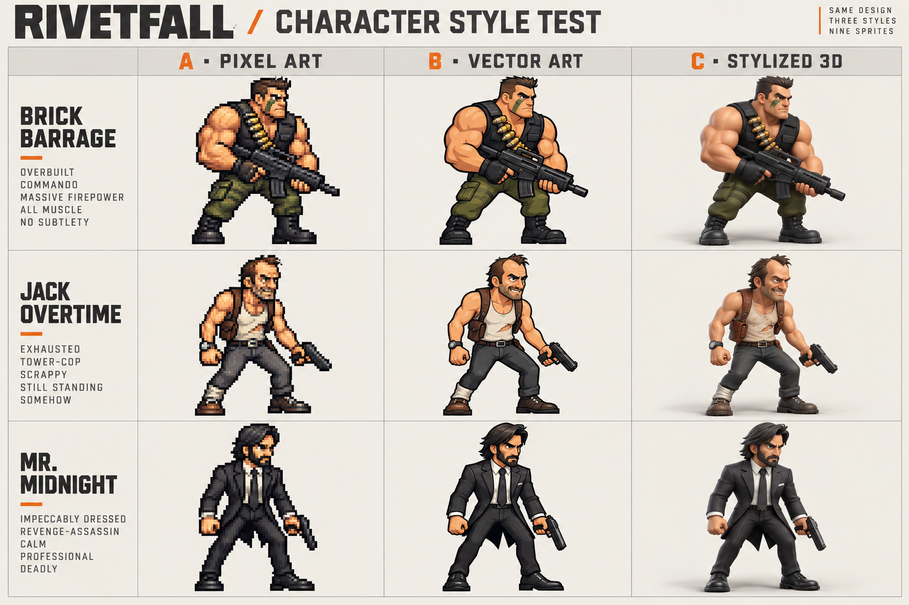

# Character art and animation studies

## Shared-rig 3D prototype

Mr. Midnight and Brick now have a working comparison prototype: two distinct character meshes use the same humanoid skeleton and one run animation. The models are adapted prototype art; this establishes the rig and rendering workflow before final character modeling.

- [Watch the 3D run comparison](shared-rig/shared-rig-run.gif).
- [60 fps video](shared-rig/shared-rig-run.mp4) and [side-view GIF](shared-rig/shared-rig-run-side.gif).
- [Interactive viewer, editable models, source credits, and rebuild instructions](shared-rig/README.md).

## Mr. Midnight — second animation test

This attempt uses illustrated sprite frames based on Mr. Midnight in column **B** of the original style sheet. It keeps the character's face, suit, and proportions, with twelve poses in a 0.6-second run cycle. It is an animation approval test, not yet integrated into gameplay.

**Motion review: this attempt does not yet pass.** The generated frames repeat the leading leg instead of establishing a clear opposite stride in the second half, so the loop can read as skipping. Frame alignment and timing are working, but those technical checks do not establish a convincing run. The next animation pass needs deliberately constructed alternating poses; changing the visual style alone will not correct the sequence.

- [Looping GIF](mr-midnight-run-v2.gif) — twelve poses at 20 fps.
- [MP4 video](mr-midnight-run-v2.mp4) — six repeats. Download the raw file if GitHub does not preview it.
- [Interactive HTML](mr-midnight-run-v2.html) — download the raw file and open it offline to pause, change speed, face either direction, or inspect individual poses. GitHub displays its source rather than running the page.
- [Source sprite sheet](mr-midnight-run-v2-sheet.png) and [still frame](mr-midnight-run-v2.png).

The source is raster artwork with the cel-shaded appearance of the sample sheet. Playback uses the twelve illustrated poses directly, with shared scale and frame-position corrections; it does not interpolate additional poses. The HTML embeds the source image and needs no network access.

To reproduce the exports, install the repository dependencies, FFmpeg (including `ffprobe`), and Chromium, then run `node scripts/render-midnight-sprite-run.mjs`. Set `CHROMIUM_PATH` if Chromium is not at `/usr/bin/chromium`. The interactive page is also available at `/docs/art-direction/mr-midnight-run-v2.html` while `npm run dev` is running.

## Earlier procedural vector run test

A single vector animation study for approval: Mr. Midnight runs with a compact pistol carry, bent recovery knees, and movement in his hair, tie, and jacket tails.

- [Looping GIF](mr-midnight-run.gif) — quick preview, 50 fps.
- [MP4 video](mr-midnight-run.mp4) — 60 fps, six repeats of the 0.8-second cycle. On GitHub, download the raw file to play it if the video does not preview.
- [Interactive HTML](mr-midnight-run.html) — download the raw file and open it in a browser. It runs offline and supports pause, half speed, frame scrubbing, and facing left or right. GitHub displays its source rather than running the page.
- [Still frame](mr-midnight-run.png).

These are isolated review assets; the character and animation are not integrated into gameplay yet. The HTML contains the original SVG artwork and animation rig, with no external assets or libraries. It respects the browser's reduced-motion preference by starting paused.

To view the interactive study from a local checkout, run `npm install` and `npm run dev`, then open `/docs/art-direction/mr-midnight-run.html` on the Vite server. To regenerate the exports, install FFmpeg (including `ffprobe`) and Chromium, then run `node scripts/render-midnight-run.mjs`. Set `CHROMIUM_PATH` if Chromium is not at `/usr/bin/chromium`.

## Character style comparison

This is an art-direction proposal awaiting approval. It is not integrated into the game.

- **A — Pixel art:** chunky retro arcade sprites.
- **B — Vector art:** clean outlines and cel shading.
- **C — Stylized 3D:** rounded, volumetric action-figure rendering.

The rows show **Brick Barrage** (commando), **Jack Overtime** (tower cop), and **Mr. Midnight** (suited assassin). These are original action-hero parodies. Names, costumes, and proportions are also open for review.

Open the PNG above to inspect it at full size. On GitHub, use the download button or **Raw** to save the image if the preview does not load.
