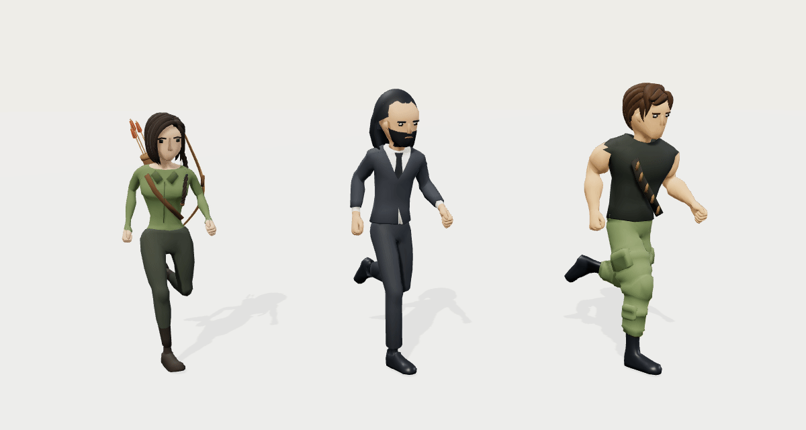

# Shared-rig 3D prototype

Mr. Midnight (left) and Brick Barrage (right) use different character meshes with one shared humanoid skeleton definition and one run animation. This is an isolated pipeline test; these models are not integrated into the game.



- [60 fps video](shared-rig-run.mp4) — six repetitions of the 0.8-second cycle. Download the raw file if GitHub does not play it inline.
- [Side-view GIF](shared-rig-run-side.gif) — inspect the alternating legs and footfalls.
- [Still image](shared-rig-run.png).
- [Interactive 3D viewer](viewer.html) — orbit the models, switch front/side views, pause, scrub, change speed, and display the skeletons. GitHub shows the HTML source; run it locally using the instructions below.
- [Animated GLB](shared-rig.glb) — import into Blender or another glTF-compatible tool.
- [Editable Blender scene](../../../art/characters/shared-rig/shared-rig.blend).

## What this verifies

The Blender scene contains two instances of the **same 62-bone Armature data** and the **same Run Action**. The models have distinct meshes, proportions, clothing, materials, and accessories. Their bone poses match at corresponding timestamps. Each character instance gets its own bone nodes in GLB, as required to place two characters independently, while using the same compatible skeleton structure and one combined animation clip.

Independent checks confirm normalized skin weights, fixed bone lengths, alternating foot motion, and exact equality of all bone transforms at the loop boundary. The GLB contains one 0.8-second `Run` clip controlling both characters. Video frames are sampled directly from the rigged 3D scene at 60 fps; the GIF uses separate evenly spaced samples at 50 fps.

The original authored run approached its starting pose without including a duplicate closing pose. The build preserves every authored key value, appends that closing pose one source-frame interval later, and uniformly retimes the completed cycle to 0.8 seconds. The source GLBs remain unchanged. See [metadata.json](metadata.json) and [the editable asset's verification report](../../../art/characters/shared-rig/verification.json).

## Art status

These are **adapted prototype models**, based on Quaternius's CC0 modular characters. They demonstrate the shared-rig approach rather than final likeness to the illustrated character sheet. Mr. Midnight combines the suit with a customized head, hair, and beard. Brick has broader arms/chest, tactical trousers and boots, and a bandolier. More refined character meshes can use the same compatible rig later.

[Asset provenance, licenses, and source hashes](../../../art/characters/shared-rig/SOURCES.md). Three.js is included locally under its [MIT license](THREE-LICENSE.txt); the viewer makes no CDN requests.

## Open the viewer

From the repository root:

```sh
npm install
npm run dev
```

Open the Vite server at `/docs/art-direction/shared-rig/viewer.html` (normally `http://localhost:5173/docs/art-direction/shared-rig/viewer.html`). In the cloud environment, use the forwarded Vite port with that same path. The preview requires WebGL.

## Rebuild

With Blender 4.3 or later installed:

```sh
blender -b --python scripts/build-shared-rig.py -- --preview
```

This rebuilds the editable scene, animated GLB, metadata, poster, and quarter-cycle poses. It uses EEVEE with 16 samples by default. `--render` additionally writes 48 PNG frames under `art/characters/shared-rig/renders/`; those intermediate frames are ignored by Git. Cycles CPU is available with `--engine CYCLES --samples 32`; denoising is disabled for compatibility with this cloud build.

To capture the interactive 3D scene into GIF/video previews, install FFmpeg (including `ffprobe`) and Chromium, then run:

```sh
node scripts/render-shared-rig-preview.mjs
```

The capture script starts its own local HTTP server and verifies the model and exported media. Set `CHROMIUM_PATH` if Chromium is not at `/usr/bin/chromium`.

The model adaptation logic is in `scripts/shared-rig-style.py`. The viewer source is `scripts/shared-rig-viewer.mjs`; its header documents rebuilding the local Three.js bundle without changing game dependencies.
